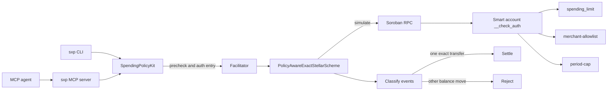

# stellar-x402-policies

Policy-aware verification for [x402](https://github.com/x402-foundation/x402) payments from Stellar smart accounts. The package sits on `@x402/stellar` `ExactStellarScheme` (2.28.x) so an existing facilitator can accept OpenZeppelin stellar-accounts that enforce policies such as `spending_limit`.

Apache-2.0.

## Problem

`ExactStellarScheme` simulates the client transaction and then requires every contract event to be the SEP-41 `transfer`. A smart account runs `__check_auth` before that transfer. Policies emit their own events there (`spending_limit_enforced`, `simple_enforced`), and the reference scan returns `invalid_exact_stellar_payload_event_not_transfer`. The x402 Stellar spec requires no other balance changes. The implementation rejects events that do not move a balance.

The same verify path caps the simulation-derived fee at `maxTransactionFeeStroops`, default **50,000** stroops. A warm smart-account payment costs about **310,000–319,000** stroops (one public run reported **324,039**). A cold account, paying first-touch TTL rent, costs about **5.71 million** stroops. The default ceiling refuses both.

`@x402/stellar` is published from [x402-foundation/x402](https://github.com/x402-foundation/x402). [coinbase/x402](https://github.com/coinbase/x402) forks that repository. The open reports are:

- [x402#3352](https://github.com/x402-foundation/x402/issues/3352) — non-transfer events from smart-account policies
- [x402#3515](https://github.com/x402-foundation/x402/issues/3515) — the 50,000-stroop fee ceiling
- [x402#3399](https://github.com/x402-foundation/x402/pull/3399) — open fix for informational simulation events (not merged)

## Architecture



`PolicyAwareExactStellarScheme` subclasses the reference facilitator scheme. On `@x402/stellar` 2.28.x the event scan is `validateSimulationEvents`. This package replaces that method, classifies each diagnostic event, drops allowlisted policy events, and calls the original scan for everything else. Auth checks, the single-transfer rule, sub-invocation rejection, and the fee comparison stay in the reference scheme. The fee comparison uses a higher ceiling.

## Event rule

Each contract event is one of:

| Class | Meaning |
| --- | --- |
| `transfer` | SEP-41 `transfer` from the payment asset, with the expected sender, recipient, and amount |
| `allowed_policy` | Non-balance-moving topic from a contract in `policyContracts`. If `policyEventTopics` is non-empty, the topic must be in that list too |
| `rejected` | Anything else that could hide a balance change |
| `ignored` | Non-contract diagnostic events, which the reference scan already skips |

These topics are balance-moving and are rejected from every contract, including an allowlisted policy: `transfer`, `mint`, `burn`, `clawback`, `approve`, `set_authorized`. Matching is case-insensitive. The payment transfer itself must be the exact symbol `transfer`.

The allowlist is the trust boundary. A policy contract can still misbehave under a topic that is not in that denylist. Set `policyEventTopics` to the events you expect, such as `spending_limit_enforced` and `simple_enforced`.

## Fee profiles

The ceiling is the same quantity the reference scheme checks: `minResourceFee + inclusionFeeStroops` (inclusion defaults to 100). It is the most the facilitator account will pay, in stroops.

| Profile | Measured cost | Default cap |
| --- | --- | --- |
| `warm` | 310,000–319,000; observed settlement 324,039 | 500,000 |
| `cold` | about 5,710,000 (first-touch rent) | 6,500,000 |

`warm` is the default. `cold` is opt-in because the facilitator spends the rent. `maxTransactionFeeStroops` replaces the profile cap when you set it. `getExtra` publishes the active ceiling, profile, and allowlist for `GET /supported`.

## Usage

```typescript
import { createEd25519Signer } from "@x402/stellar";
import { PolicyAwareExactStellarScheme } from "stellar-x402-policies";

const secret = process.env.FACILITATOR_SECRET_KEY;
if (!secret) {
  throw new Error("FACILITATOR_SECRET_KEY is required");
}

const signer = createEd25519Signer(secret, "stellar:testnet");
const scheme = new PolicyAwareExactStellarScheme([signer], {
  rpcConfig: { url: "https://soroban-testnet.stellar.org" },
  policyContracts: ["C...policy"],
  policyEventTopics: ["spending_limit_enforced", "simple_enforced"],
  feeProfile: "warm",
});
```

`readPolicyAwareOptions(process.env)` builds that options object from `POLICY_CONTRACT_IDS`, `POLICY_EVENT_TOPICS`, `FEE_PROFILE`, `WARM_FEE_CAP_STROOPS`, `COLD_FEE_CAP_STROOPS`, `MAX_TRANSACTION_FEE_STROOPS`, and `STELLAR_RPC_URL`. It does not read secret keys.

### Facilitator

`examples/facilitator` serves `GET /supported`, `POST /verify`, and `POST /settle` with the same JSON body as `@x402/core`'s HTTP client.

```bash
cp .env.example .env
# fill FACILITATOR_SECRET_KEY and POLICY_CONTRACT_IDS in .env
pnpm facilitator
```

The process listens on `127.0.0.1:4020` unless `HOST` and `PORT` say otherwise. The log line includes the public facilitator address, the fee cap, and the policy-contract count. It does not include seeds or the RPC URL.

### MCP server

`packages/mcp` (`@stellar-x402-policies/mcp`) exposes `inspect_account`, `pay`, and `estimate_fee` over stdio. `SXP_AGENT_SECRET` is the agent key. The process refuses `SXP_NETWORK=mainnet` unless `SXP_ALLOW_MAINNET=1`, and it does not write the secret to stdout or stderr.

Claude Desktop and Cursor use the same `mcpServers` entry:

```json
{
  "mcpServers": {
    "stellar-x402-policies": {
      "command": "node",
      "args": ["packages/mcp/dist/stdio.js"],
      "env": {
        "SXP_ACCOUNT": "C...",
        "SXP_AGENT_SECRET": "S...",
        "SXP_RPC_URL": "https://soroban-testnet.stellar.org",
        "SXP_FACILITATOR_URL": "http://127.0.0.1:4020",
        "SXP_NETWORK": "testnet"
      }
    }
  }
}
```

Build the server first with `pnpm --filter @stellar-x402-policies/mcp build`. The `S...` value in that snippet is a placeholder for the agent key only, never the owner key.

### Testnet demo

`examples/testnet-demo` prints the resolved public config. When `PAYMENT_TRANSACTION_XDR` is set, it verifies that payload. `SETTLE=true` submits it. The payer seed in `.env.example` is for a separate client; this script does not read `PAYER_SECRET_KEY`.

```bash
cp .env.example .env
pnpm --filter stellar-x402-testnet-demo demo
```

## Live on testnet

`pnpm live` runs the settlement on Stellar testnet from `examples/testnet-demo`. It generates throwaway keypairs, funds the accounts with [Friendbot](https://friendbot.stellar.org), deploys an OpenZeppelin stellar-accounts instance from the protocol-27 WASM already on testnet, and installs a `spending_limit` rule for the native asset contract. The seeds stay in process memory. The script does not read or write `.env`.

The same unsigned payment was rejected by `ExactStellarScheme` and then settled by `examples/facilitator` (`PolicyAwareExactStellarScheme`, cold profile, cap 6,500,000 stroops). A second payment from the same account measured the fee after the policy had extended its TTL. Details and the setup transactions are in [docs/testnet-results.md](docs/testnet-results.md).

| | What the scheme simulated | Fee charged | Transaction |
| --- | ---: | ---: | --- |
| Reference, default 50,000 stroop ceiling | 369,788 | not submitted | `invalid_exact_stellar_payload_fee_exceeds_maximum` |
| Reference, ceiling raised above that fee | same payload | not submitted | `invalid_exact_stellar_payload_event_not_transfer` |
| Cold settlement (first `spending_limit` TTL extension) | 369,788 | 318,897 | [`2ecdc5d2…ea38`](https://stellar.expert/explorer/testnet/tx/2ecdc5d2ff530b0347a9bf6d8033f162036ccbd9ee435328b84c5adf0d61ea38) |
| Warm settlement (TTL already extended) | 58,328 | 48,067 | [`eee416ae…ef01`](https://stellar.expert/explorer/testnet/tx/eee416ae7b39839ab689e63ffb2a8e33924f4b6fb906f973eb47778dc16eef01) |

Both settled payments moved 0.1 XLM from smart account `CA37FAB2OXRQLTMKR36QXMT3JREOVIEDDK7SW3YCAB6NRZZNZUG7K7BV` on 2026-10-26 (ledgers 5,405,125 and 5,405,126). The simulated fee is `minResourceFee` plus the 100-stroop inclusion buffer. The charged fee is lower because the network refunds unused resources.

## Accounts release

Policies in this repository are built on **stellar-accounts 0.8.0** (soroban-sdk 28.0.0, published 2026-10-20). Per-asset rolling caps use the OpenZeppelin `spending_limit` contract, one `CallContract(token)` rule per asset. This repository does not reimplement that policy. The testnet singleton from the 0.8.0 deployment is `CC3CEYQAP6NPNFIYSWL5MVZRCPJZGWX4XO7WDEJOUVGO2FZX5OONYPA5`.

OpenZeppelin has not planned a recipient-allowlist policy. [stellar-contracts#514](https://github.com/OpenZeppelin/stellar-contracts/issues/514) is a general smart-account tracker, and the nearby policy issues are `spending_limit` (#649), an external generator (#850), and a frequency limit (#858). The finding is written up in [docs/oz-recipient-allowlist.md](docs/oz-recipient-allowlist.md). `contracts/merchant-allowlist-policy` is this repository's policy on the public `Policy` trait. `contracts/period-cap-policy` is a calendar cap (one counter, reset at `anchor_ledger + k * period_ledgers`) plus `per_tx_max`.

Protocol 30 muxed contract addresses (CAP-84, strkey `W`) are decoded in the verifier and matched to the base contract only when `matchMuxedContract` / `MATCH_MUXED_CONTRACT=1` is set. `@stellar/stellar-sdk` 16.4 and soroban-sdk 28 do not ship a `MuxedAddress` type. The on-chain per-id matcher is the cargo feature `p30`.

Testnet deployments (Friendbot deployer, seeds not stored) are in [deployments/testnet.json](deployments/testnet.json):

| Policy | Contract | Wasm hash |
| --- | --- | --- |
| merchant-allowlist | `CAP53MP7CWG3TTOQNMICVSNIBFMNEE7HYNOK4O2OP3FVBBB4YK6UAZP6` | `37ee5ee8184a7860b4f13a029a3301639ce54b41eee65360e2f60111e0fba141` |
| period-cap | `CB2VQO2NYP4DJBPNCZGRGEUKIUCK7BJW66OXEPDHV7RJT2ICW23X3EL5` | `da75bb6a574dea02688af68f4d7015cf8806cd6cea52a62d8670b754e804a807` |

Allowance templates live in `templates/`. Each one keeps a `Default` owner rule (`ed25519` or `passkey`) and sets `validUntil` on the agent rule.

## Agent spending-policy kit

The kit is the client side of the verifier. `packages/sdk` builds the auth entry and refuses a payment locally when a policy would reject it. `packages/mcp` exposes that to an agent. `packages/inspector` is the `sxp` CLI.

```typescript
import { Ed25519Signer, SpendingPolicyKit } from "@stellar-x402-policies/sdk";
import { Keypair } from "@stellar/stellar-sdk";

const kit = new SpendingPolicyKit({
  rpcUrl: "https://soroban-testnet.stellar.org",
  networkPassphrase: "Test SDF Network ; September 2015",
  facilitatorUrl: "http://127.0.0.1:4020",
  sourceAccount: "G...",
  verifier: "CAAVTMCBXEIBPR64EAASKFXERVPYFZA2JYP5A3BG6PESWEFUJX5IHKN4",
  agentAccount: "G...",
});
const report = await kit.inspect("C...");
const fee = await kit.estimateFee(requirements, "C...");
const decision = await kit.precheck(requirements, "C...");
const receipt = await kit.pay(requirements, {
  signer: new Ed25519Signer(Keypair.fromSecret(process.env.SXP_AGENT_SECRET ?? "")),
  maxAmount: 2_000_000n,
  account: "C...",
});
```

`SXP_AGENT_SECRET` is the agent key. The owner key stays out of the MCP server. `pnpm demo` runs the testnet script in `examples/demo`: Friendbot keys, a v0.8.0 smart account, merchant A at 0.3 XLM/day, and the MCP pay sequence. Results land in [docs/testnet-results-kit.md](docs/testnet-results-kit.md).

### CLI

```bash
pnpm --filter @stellar-x402-policies/inspector build
sxp inspect C... --json
sxp fee requirements.json --account C...
sxp templates list
sxp templates apply agent-merchant-allowlist --account C... --params params.json --dry-run
sxp allowlist export
```

`sxp allowlist export` prints `X402_POLICY_EVENT_CONTRACTS` from [deployments/testnet.json](deployments/testnet.json). The facilitator reads that name and `POLICY_CONTRACT_IDS`.

The MCP `mcpServers` snippet is in the section above. `SXP_NETWORK=mainnet` refuses to start unless `SXP_ALLOW_MAINNET=1`.

### Security

[docs/threat-model.md](docs/threat-model.md) is the kit's threat model. The short version:

- The verifier still requires exactly one `transfer` and drops only non-balance-moving events from allowlisted policy contracts.
- Caps, the merchant allowlist, `valid_until`, and the per-transfer max are enforced in the account, so a prompt cannot raise them.
- The MCP process holds the agent key and never the owner key. A short `valid_until` limits a leaked agent key.
- Warm and cold fee ceilings bound what a payer can make the facilitator spend.
- `sxp inspect` warns when an agent rule has no expiry, when spending history is above 80% of 815 entries, and when a policy contract is missing from the verifier allowlist.

## Development

Node.js 22 and pnpm 10.

```bash
pnpm install
pnpm lint
pnpm build
pnpm typecheck
pnpm test
```

## Future work

A conformance suite across more smart-account policies is the next piece. An optional extension can register one more allowlisted policy contract beside the policies this package already accepts. That extension stays outside this package.

## License

Apache-2.0. See [LICENSE](LICENSE) and [NOTICE](NOTICE).
